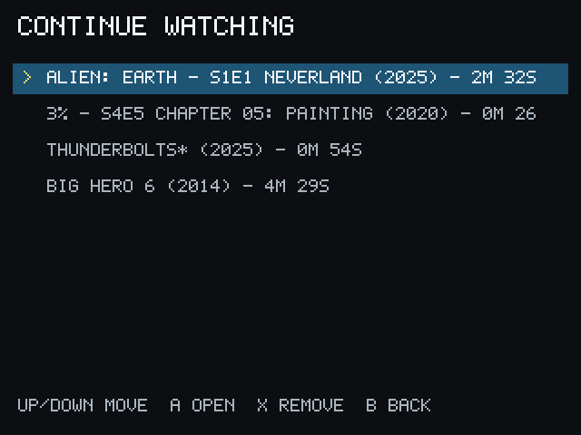
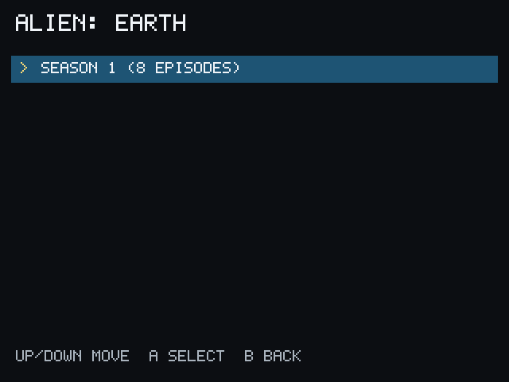

# Continue Watching

PocketCinema keeps a compact Continue Watching list for playback with valid
progress.

## Continue a title

1. Choose **Continue Watching** from Home.
2. Select an item.
3. Choose the available resume or playback action.

For a series, open the series from Search or My Library and use the available
resume or playback action. You can also choose a season and episode manually
through the normal series browsing flow. PocketCinema does not expose a
separate automatic episode-advance screen or action in the supported v1 UI.

During playback, the Miyoo Menu button exits. PocketCinema excludes startup and
unverified pause time from saved progress.
