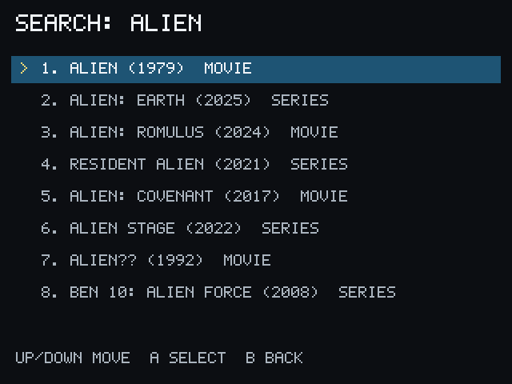
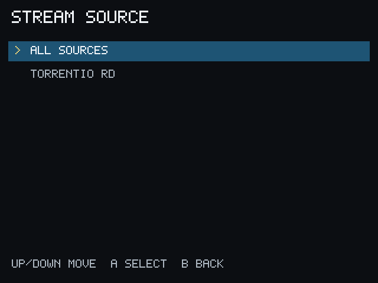
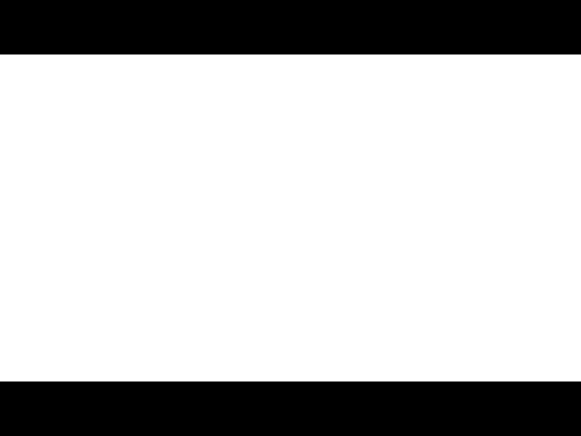

# Watch your first movie

This is the shortest path from a connected Miyoo to playback.

1. From Home, select **Search**.
2. Enter a movie title.
3. Select a result marked **MOVIE**.
4. Select **Play**.
5. Select a source. See [Choose a Source](sources.md) for help reading the
   choices.
6. Select subtitles, or choose **No subtitles**, when the subtitle screen
   appears.
7. Wait for playback to begin.

During playback, use the Miyoo Menu button to exit and return to PocketCinema.
PocketCinema saves valid watched progress when possible.

