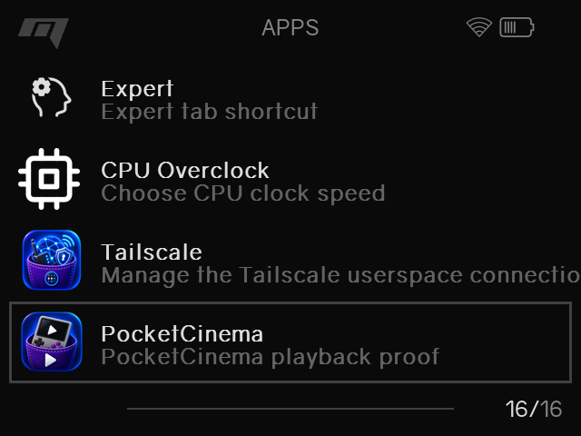

# Install PocketCinema on the Miyoo

Use the release package intended for your OnionOS version. Copy the PocketCinema
application into:

`/mnt/SDCARD/App/PocketCinema/`

The app should appear in the OnionOS Apps menu after the SD card is inserted
back into the Miyoo. Launch it from there.

PocketCinema and the optional Tailscale companion are separate applications:

- PocketCinema: `/mnt/SDCARD/App/PocketCinema/`
- Tailscale companion: `/mnt/SDCARD/App/Tailscale/`

Do not merge these directories or copy Tailscale state into PocketCinema.

After launching, continue with [Connect PocketCinema](connect.md).
