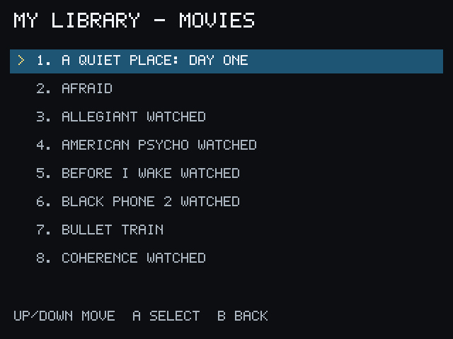

# My Library

**My Library** displays Movies and Series from the linked Stremio account.

1. Choose **My Library** from Home.
2. Choose **Movies** or **Series**.
3. Select an item to continue into its normal details, episode, source, and
   playback flow.

Long lists may use more than one page. Watched or current markers may appear
when the account provides that information.

PocketCinema's Library is read-only. It does not add, remove, or edit items in
your Stremio account.

If the Library is empty, confirm that the intended Stremio account is linked and
that its addons or service are available.
